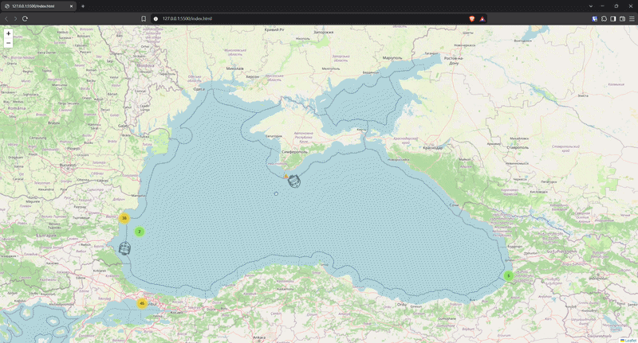

# BlackSeaAIS

Live link: https://alexgp32.github.io/BlackSeaAIS/



## Description

A C# application that connects to the AIS stream from aisstream.io, tracks ships in the Black Sea in real-time, and saves their current positions and movement history into a Postgres database. It includes a live interactive map that displays ships directly in the browser. Incoming positions are continuously validated using geographic boundaries and speed heuristics to detect GPS spoofing and physically impossible movements.

## Technologies

**Backend**

- C# / .NET 9
- Npgsql
- WebSocket
- NetTopologySuite

**Testing**

- xUnit
- Moq

**Database**

- Postgres / Supabase

**Frontend**

- Leaflet.js (interactive map)
- Leaflet.markercluster (visual grouping of nearby ships)
- Supabase JS (live data reading from the browser)

**Deployment**

- GitHub Actions (CI/CD pipeline)
- Linux (Ubuntu) & systemd daemon services

## Project Structure

```
BlackSeaAIProject/
├── BlackSeaAIS.sln
├── BlackSeaAIS/          # Main application
└── BlackSeaAIS.Tests/    # Unit tests
```

| File / Folder              | Role                                                                                     |
| -------------------------- | ---------------------------------------------------------------------------------------- |
| `Program.cs`               | Handles connection and the reconnection loop                                             |
| `AiStreamClient.cs`        | WebSocket connection, subscription, receiving AIS messages                               |
| `DatabaseService.cs`       | Upsert into `ships` and insert into `position_history`                                   |
| `GeoValidationService.cs`  | Validates if a position falls on land (possible GPS spoofing)                            |
| `IGeoValidationService.cs` | Validation service interface (allows mocking in tests)                                   |
| `AisModels.cs`             | Classes mirroring the structure of incoming JSON messages                                |
| `Data/`                    | GeoJSON files (`land_polygons.geojson` & `safe_zones.geojson`) for geospatial validation |
| `index.html`               | Live map of ships, read directly from Supabase                                           |
| `css/`, `js/`              | Leaflet and Supabase libraries, used locally by `index.html`                             |
| `BlackSeaAIS.Tests/`       | Unit testing project (xUnit + Moq)                                                       |

## Running — Backend

### 1. aisstream.io API Key

Create a free account on [aisstream.io](https://aisstream.io) and generate an API key.

### 2. Postgres Database

Create your own project on [Supabase](https://supabase.com) (or use any Postgres instance). Run the SQL from the **Database Structure** section below to create the necessary tables before the first run.

### 3. Row Level Security (RLS)

The `ships` table must have a public read policy; otherwise, the map in `index.html` will not receive data (Supabase returns an empty response without an explicit error if RLS is active but no policy exists).

In Supabase, go to **Authentication → Policies → ships → Create policy**, and create a policy:

- **Command**: `SELECT`
- **Target roles**: default (all public roles)
- **USING expression**: `true`

Repeat the same policy for the `position_history` table, otherwise the ship routes will not be visible on the map.

### 4. Environment Variables

Create an `.env` file in the `BlackSeaAIS/` folder (next to `BlackSeaAIS.csproj`), with the following variables:

| Variable                     | Description                                                                                                                   |
| ---------------------------- | ----------------------------------------------------------------------------------------------------------------------------- |
| `AISSTREAM_API_KEY`          | The API key obtained from aisstream.io                                                                                        |
| `PASSWORD`                   | Your Supabase database password                                                                                               |
| `SUPABASE_CONNECTION_STRING` | The full Postgres connection string (Supabase Dashboard → Settings → Database → Connection string, "Transaction pooler" mode) |

### 5. Running the application

```bash
cd BlackSeaAIS
dotnet run
```

## Running — Frontend (Live Map)

`index.html` reads directly from Supabase, using the public `anon` key.

1. Open `index.html` with a local server (e.g., the **Live Server** extension in VS Code).
2. If using your own Supabase project, replace the URL and `anon` key in `index.html` with yours (Supabase Dashboard → Settings → API).

The map updates automatically every 5 seconds, showing the last known position of each ship. A ship's route ("View Route" button in the popup) automatically excludes positions marked as implausible.

## Tests

From the folder containing the `.sln` file:

```bash
dotnet test
```

Unit tests cover:

- **`GeoValidationService`**: land detection, using a synthetic polygon instead of the real GeoJSON file (interior, exterior, boundary threshold, lat/lon order, empty polygon list). It also tests the safe zones override logic.
- **`DatabaseServiceTests`**: plausibility logic, with `IGeoValidationService` replaced by a mock (Moq)
- **`AisMessageTests`**: AIS message deserialization

The SQL operations in `UpsertShip` and `InsertHistory` are not covered by unit tests, as they require a real Postgres instance.

## Database Structure

### `ships` Table

Stores the **last known position** for each ship (upsert by MMSI).

```sql
CREATE TABLE IF NOT EXISTS ships (
    mmsi BIGINT PRIMARY KEY,
    ship_name TEXT,
    last_latitude DOUBLE PRECISION,
    last_longitude DOUBLE PRECISION,
    sog DOUBLE PRECISION,
    cog DOUBLE PRECISION,
    true_heading INTEGER,
    navigational_status INTEGER,
    last_update TIMESTAMPTZ,
    is_plausible BOOLEAN DEFAULT TRUE
);
```

### `position_history` Table

Stores the **complete history** of positions per ship (a new row for each received message).

```sql
CREATE TABLE IF NOT EXISTS position_history (
    id SERIAL PRIMARY KEY,
    mmsi BIGINT,
    latitude DOUBLE PRECISION,
    longitude DOUBLE PRECISION,
    recorded_time TIMESTAMPTZ,
    is_plausible BOOLEAN DEFAULT TRUE,
    FOREIGN KEY (mmsi) REFERENCES ships(mmsi)
);
```

`is_plausible` indicates whether the position passed geographic and speed validations. In position_history, all positions are saved but simply flagged, to keep the full history available for analysis. In ships, an implausible position does not overwrite the ship's last valid position; it only marks the ship as implausible.

## Plausibility Filtering: Geographic & Speed Heuristics

The Black Sea region is known for widespread GPS spoofing. Ships report AIS positions that do not correspond to their real location, either placing them inland or "teleporting" them across vast distances instantly.

To filter this, the application applies a two-layer validation system. Positions failing either check are marked is_plausible = false.

1. Geographic Land Validation
   Each received position is validated against a land/sea geometry (source: Natural Earth, 1:50m resolution) using NetTopologySuite. A point is considered on land only if it is inside a land polygon and further from the boundary than a 0.002-degree threshold (~200m).

Safe Zones Exception: Because low-resolution maps can cause false positives in narrow canals or specific ports, the application checks a safe_zones.geojson file. If a point is detected as being on land but falls inside a designated safe zone polygon, the anomaly is overridden.

2. Speed Heuristics
   To detect spoofing artifacts that occur over water, the system calculates the required speed to travel between the ship's last known valid position and its newly reported position within the elapsed time. If the calculated speed exceeds physically realistic limits for a maritime vessel, the coordinate is flagged as an artificial teleportation artifact.

## Features

- Live connection to the AIS stream, filtered by a bounding box in the Black Sea
- Deserialization of AIS messages into strongly typed C# objects
- Automatic CI/CD pipeline deployment via GitHub Actions to a Linux production environment
- Service execution managed via a systemd daemon for background processing and auto-restarts
- Automatic upsert of each ship's last position
- Saving of the complete movement history
- Geographic validation of positions to detect GPS spoofing
- Speed heuristic validation to filter out impossible coordinate jumps
- Custom geospatial safe zones to prevent false positives in narrow ports and canals
- Unit tests for geographic validation, safe zones logic, and plausibility logic
- Automatic WebSocket reconnection in case of connection loss
- Error handling for deserialization and database operations without crashing the program
- Live interactive map with visual clustering of nearby ships
- Ships with outdated positions (over 1 hour old) are rendered with increased transparency (35% opacity) on the map, visually distinguishing active live traffic from inactive or disconnected vessels.
- Rotation of each ship's icon based on its true heading
- Historical route display for a ship upon request (valid routes in blue, implausible points marked as red circles)
- Visual warnings for ships with suspicious positions
- Automatic map updates every 5 seconds

## Known Limitations

- Land detection accuracy depends on the GeoJSON file's resolution. Unmapped narrow canals might still trigger false positives if not explicitly added to `safe_zones.geojson`.
- Dependency on an external API (aisstream.io) for receiving and updating data.
- Expanding the database to monitor multiple regions or the entire globe would quickly cause storage bottlenecks due to the massive volume of history data.
